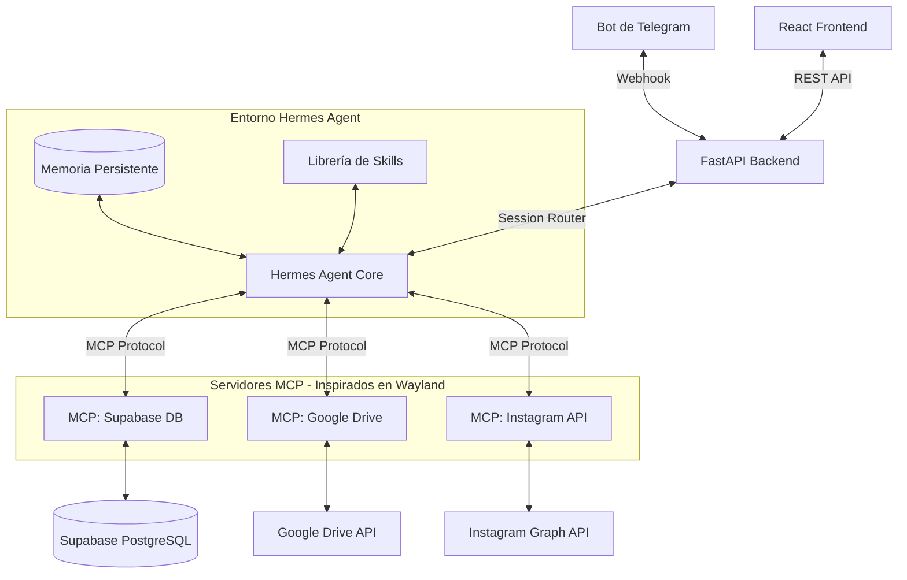

# Plan de Integración y Optimización: Hermes Agent & Wayland en SocialLab 🚀

Este documento consolida la propuesta técnica de integración del framework **Hermes Agent** (memoria persistente y skills) y los conceptos de **Wayland** (nativismo MCP), junto con las especificaciones técnicas para lograr la máxima eficiencia en el uso de tokens, fluidez de la app y análisis de imágenes.

---

## PARTE 1: PROPUESTA DE INTEGRACIÓN DE AGENTES (HERMES & WAYLAND)

### 1. Arquitectura Objetivo (Híbrida)

La integración transforma el pipeline secuencial y rígido actual en una arquitectura agéntica desacoplada usando **Model Context Protocol (MCP)**.



---

### 2. Qué podemos integrar exactamente

#### De Wayland (Modularidad y Protocolo)
* **Model Context Protocol (MCP):** Convertir las integraciones síncronas de base de datos, Drive e Instagram de SocialLab en herramientas estándar (servidores MCP). Esto permite que el agente consuma los servicios de forma declarativa sin acoplar funciones de Python.

#### De Hermes Agent (Orquestador y Persistencia)
* **Memoria Persistente (Long-term Memory):** Sustituir la generación estática por una sesión de chat permanente con Hermes. El agente recordará el histórico de correcciones del usuario en Telegram.
* **Librería de Skills Dinámicas:** Permitir al agente generar scripts independientes (como procesamiento de estadísticas deportivas con Pandas o renderizado de layouts) y guardarlos como habilidades del sistema.

---

### 3. Impacto en la Base de Código (Archivos Afectados)

La integración afectará principalmente a las capas de servicios y rutas del backend:

#### 🛠️ Código a Depreciar o Simplificar significativamente
1. **[agent_service.py](file:///Users/joseangel/Downloads/Projects/sociallab/backend/services/agent_service.py):** Toda la lógica compleja de escaneo (`_scan_drive`), análisis secuencial (`_analyze_images`) y construcción de slots (`_build_calendar`) es absorbida por el bucle de razonamiento autónomo y las herramientas MCP de Hermes.
2. **[telegram_service.py](file:///Users/joseangel/Downloads/Projects/sociallab/backend/services/telegram_service.py):** Se elimina el parseador manual basado en expresiones regulares y callbacks (`approve:`, `reject:`, `edit_text:`, `timeedit_:`). El bot solo actúa como puente de mensajes de texto naturales hacia el agente.

#### 🆕 Código a Implementar
1. **`backend/mcp/` (Servidores MCP):** Envolturas MCP para exponer:
   * Lectura de Drive y templates.
   * Escritura y actualización en Supabase.
   * Publicación directa en Instagram.
2. **`backend/services/hermes_orchestrator.py`:** Inicializador del daemon de Hermes Agent con su base de datos de memoria persistente local (SQLite o PostgreSQL).
3. **[telegram_routes.py](file:///Users/joseangel/Downloads/Projects/sociallab/backend/routes/telegram_routes.py) & [agent_routes.py](file:///Users/joseangel/Downloads/Projects/sociallab/backend/routes/agent_routes.py):** Modificar endpoints para redirigir los payloads del webhook de Telegram y del disparador manual al orquestador de Hermes.

---

### 4. Fases de Implementación y Estimación de Tiempos

El proyecto se puede migrar en **3 Fases** a lo largo de un período estimado de **2 a 3 semanas**.

#### 📅 Cronograma Propuesto

| Fase | Tareas Clave | Cambios en Código | Esfuerzo Estimado |
| :--- | :--- | :--- | :--- |
| **Fase 1: Capa MCP**<br>*(Estilo Wayland)* | • Instalar `mcp` SDK.<br>• Crear wrappers de Supabase, Google Drive e Instagram como herramientas MCP.<br>• Validar ejecución local de herramientas. | • Crear `backend/mcp/`<br>• Envolver servicios en `backend/services/`. | **4 - 5 días** |
| **Fase 2: Motor Hermes**<br>*(Orquestación)* | • Instalar y configurar `Hermes Agent` daemon.<br>• Diseñar Prompt del Sistema con reglas de la HK Football League.<br>• Configurar base de datos de memoria para el agente.<br>• Sustituir pipeline de `agent_service.py` por llamada a Hermes. | • Reemplazar [agent_service.py](file:///Users/joseangel/Downloads/Projects/sociallab/backend/services/agent_service.py).<br>• Actualizar [agent_routes.py](file:///Users/joseangel/Downloads/Projects/sociallab/backend/routes/agent_routes.py). | **6 - 7 días** |
| **Fase 3: Telegram Natural**<br>*(Experiencia)* | • Conectar webhook de Telegram directamente con la sesión de Hermes.<br>• Implementar parseo de respuestas conversacionales.<br>• Pruebas de integración de punta a punta. | • Rediseñar [telegram_service.py](file:///Users/joseangel/Downloads/Projects/sociallab/backend/services/telegram_service.py).<br>• Modificar [telegram_routes.py](file:///Users/joseangel/Downloads/Projects/sociallab/backend/routes/telegram_routes.py). | **4 - 5 días** |

**Tiempo Total Estimado:** **14 - 17 días hábiles** (aproximadamente 3 semanas de desarrollo para un ingeniero).

---

### 5. Pros y Contras de la Integración

#### ✅ Ventajas
* **Steerability extrema:** Las captions y calendarios se ajustarán dinámicamente al feedback en lugar de seguir instrucciones estáticas.
* **Mantenimiento simplificado:** Menos código personalizado para manejar interacciones de Telegram (adiós a las expresiones regulares para capturar clicks).
* **Flexibilidad de modelos:** Cambiar de Gemini a otro modelo abierto (DeepSeek, Hermes 3, Llama) es inmediato gracias al protocolo MCP.

#### ⚠️ Desafíos y Costos
* **Latencia:** El bucle de pensamiento de Hermes Agent (razonamiento + llamadas a herramientas secuenciales) puede tardar entre 15 y 30 segundos en responder un mensaje de Telegram, comparado con la respuesta instantánea del bot actual.
* **Mayor complejidad en producción:** Requiere desplegar y monitorear el proceso del agente Hermes de forma persistente junto a FastAPI.
* **Consumo de Tokens:** El uso continuo de memoria y bucles de razonamiento consume considerablemente más tokens por ejecución que los prompts directos actuales.

---

## PARTE 2: ESPECIFICACIONES DE OPTIMIZACIÓN Y EFICIENCIA

Esta sección detalla cómo contrarrestar los desafíos de latencia y tokens planteados en la Parte 1 al integrar Hermes y Wayland.

### 6. Estrategia de Optimización de Tokens (Ahorro de Costos)

#### 6.1 Prompt Caching (Nativo de Gemini API)
Dado que Hermes utiliza la API de Gemini (aprovechando tu suscripción Pro/Pay-As-You-Go), utilizaremos caching para evitar el cobro repetitivo de contextos estáticos:
* **Qué se cachea:** El prompt del sistema de la liga, la estructura de la base de datos de Supabase y las firmas JSON de las herramientas MCP.
* **Frecuencia:** Se mantiene activo por períodos de 1 hora en la caché del servidor de Gemini.
* **Beneficio:** **Ahorro de hasta un 90% en tokens de entrada** y una reducción del 50% en el tiempo de respuesta inicial (Time-to-First-Token).

#### 6.2 Compresión de Contexto (Ventanas Deslizantes y Resumen)
* **Fórmula:** Mantener solo los últimos **5 a 8 mensajes** en formato de texto plano literal.
* **Summarization:** Los turnos más antiguos se condensan automáticamente mediante una llamada rápida de resumen.
  * *Ejemplo enviado a la IA:* `"El usuario ya configuró el post del lunes como un Reel y cambió el caption. Actualmente están discutiendo el post del jueves."` más los 5 mensajes recientes.

#### 6.3 Poda Dinámica de Herramientas (*Tool Pruning*)
* **Fórmula:** No enviar todas las herramientas MCP disponibles a la IA en cada llamada.
* **Filtros de contexto:**
  * Si el usuario dice: *"Quiero cambiar el pie de foto"*, el backend oculta los esquemas de herramientas de Google Drive e Instagram, y solo envía la herramienta `update_post_caption`.
  * Menos herramientas en el prompt = menos tokens consumidos por turnos de razonamiento.

---

### 7. Optimización de la Fluidez de la App (Rendimiento y Latencia)

#### 7.1 Enrutamiento Híbrido (Deterministic vs. Agentic Routing)
No todas las acciones del usuario requieren que la inteligencia artificial razone.
```
                           [ Mensaje del Usuario ]
                                      │
                             (Es comando simple?)
                                 /          \
                             [SÍ]            [NO]
                             /                  \
              [ Enrutador Determinista ]     [ Hermes Agent Core ]
                         │                               │
             (Ejecución Directa en DB)       (Bucle de Razonamiento ReAct)
                         │                               │
            • Aprobación de propuestas       • "Cambia el tono del jueves"
            • Rechazo de posts               • "Reagenda la semana"
            • Comando /start                 • Consultas de estrategia
```
* **Implementación:** El backend intercepta los comandos estructurados (como botones callback de Telegram y botones de la interfaz React) y los ejecuta inmediatamente mediante llamadas a base de datos, omitiendo la llamada a Hermes.

#### 7.2 Streaming de Estado en Interfaces (Telegram y React)
* **Latencia Percibida:** En lugar de dejar al usuario esperando 20 segundos sin respuesta mientras el agente razona y llama a herramientas:
  1. El bot de Telegram responde de inmediato: `🤖 Procesando tu solicitud...`.
  2. Conforme el agente ejecuta pasos intermedios, se edita el mensaje en Telegram:
     * `🤖 Escaneando imágenes en Drive... [OK]`
     * `🤖 Generando captions con Gemini... [OK]`
     * `🤖 Creando borrador de la propuesta semanal... [Listo]`
  3. En el frontend de React, se utiliza un sistema de *websockets* o *Server-Sent Events (SSE)* para mostrar un progreso paso a paso de lo que está haciendo el agente en segundo plano.

#### 7.3 Eliminación del Bloqueo del Event Loop en FastAPI
* **Fórmula de Corrección:**
  * Envolver todas las llamadas de base de datos y red en hilos asíncronos mediante `asyncio.to_thread` o ejecutar las rutas de FastAPI como síncronas (`def` en lugar de `async def`) para que FastAPI gestione el pool de hilos de forma nativa.
  * Utilizar `asyncio.gather` para disparar múltiples consultas independientes (ej. descargar imagen de Drive y consultar templates en Supabase) al mismo tiempo en paralelo.

---

### 8. Análisis de Imágenes Más Eficiente (Procesamiento y Visión)

#### 8.1 Análisis Reactivo mediante Webhooks (Evitar el proceso por lotes)
* **Antes:** El agente escaneaba y analizaba todas las imágenes nuevas del tirón el domingo en la noche, tardando minutos en responder.
* **Ahora:** 
  1. Se configura un Webhook (Google Drive Push Notifications o un webhook en n8n) para monitorear la carpeta de Drive.
  2. En cuanto una nueva imagen o export es subido a Drive, se dispara una tarea en segundo plano en SocialLab.
  3. La imagen es analizada individualmente en ese momento.
  4. Cuando llega la ejecución del domingo, el planificador lee los análisis directamente desde la caché de la base de datos (`visual_analyses`), tardando fracciones de segundo.

#### 8.2 Procesamiento Directo en Memoria (Evitar I/O de disco local)
* **Fórmula:** La imagen se descarga desde Drive directamente como un flujo de bytes en memoria (`io.BytesIO`) y se transmite a la API de Gemini sin escribir archivos temporales en disco, ahorrando ciclos de hardware y almacenamiento del host.

#### 8.3 Segregación de Modelos por Tareas
* **Visión y OCR:** Usar estrictamente **Gemini 2.5 Flash**. Su costo por análisis de imagen es ínfimo, tiene tiempos de latencia muy bajos y es altamente preciso leyendo texto integrado en gráficos deportivos.
* **Planificación y Redacción:** Usar **Gemini 1.5 Pro / 2.5 Pro** o **Hermes 3** únicamente en el paso de consolidación del calendario, donde se requiere un nivel de razonamiento estratégico más alto.
